<!-- Animated header -->

<p align="center">
  
</p>

<p align="center">
  <a href="mailto:guruprakash832636@gmail.com">
    
  </a>
</p>

<p align="center"></p>

<!-- About + Image -->

<table width="100%" align="center">
<tr>

<td width="55%" valign="top">

<h2>👨‍💻 About Me</h2>

- 💻 Full-Stack Developer building **real-world web apps & AI tools**
- 🏪 Building **spritPOS** — a web ERP & POS for retail shops with **AI stock forecasting**
- 🛕 Building **vTemple Web** — a React + FastAPI rebuild of a legacy temple management system
- 🤖 Learning **GenAI, RAG & Agentic AI** with Python, Ollama & ChromaDB
- 🌐 Frontend with **React, Next.js, TypeScript, Vue.js & Framer Motion**
- ⚙️ Backend with **FastAPI, Spring Boot & SQL databases**
- 🧩 Practising **DSA in Java** to sharpen problem solving
- ⚡ *Code. Learn. Build. Repeat.*

<h3>🔗 Connect with me</h3>

<a href="https://linkedin.com/in/guruprakash14">
  
</a>

<a href="https://instagram.com/guru_prakash.r">
  
</a>

<a href="mailto:guruprakash832636@gmail.com">
  
</a>

<a href="https://github.com/GuruPrakash2004">
  
</a>

</td>

<td width="45%" align="center">



</td>

</tr>
</table>

<p align="center"></p>

<!-- Journey -->

<h2 align="center">🧭 My Journey</h2>

<p align="center">
  
</p>

<p align="center"></p>

<!-- Featured Projects -->

<h2 align="center">🔥 Featured Projects</h2>

<p align="center">
  <a href="https://github.com/GuruPrakash2004/spritPOS"></a>
  <a href="https://github.com/GuruPrakash2004/E_MANTHIRA"></a>
</p>

<table width="100%">
<tr>
<td width="50%" valign="top">

### 🤖 [Agentic-AI — RAG from Scratch](https://github.com/GuruPrakash2004/Agentic-AI)
Chat with a PDF or text file. A beginner-friendly RAG pipeline built **without LangChain**: chunking → embeddings → ChromaDB similarity search → local LLM answer via Ollama.


</td>
<td width="50%" valign="top">

### 📄 [Document Version Control System](https://github.com/GuruPrakash2004/Document-version-control-system)
Version control built for DOCX & PDF files — snapshot + delta storage, smart diffs, image tracking and **AI-powered change summaries**, with a GUI.


</td>
</tr>

<tr>
<td width="50%" valign="top">

### 🧠 [learning-GenAI](https://github.com/GuruPrakash2004/learning-GenAI)
My GenAI learning lab — Python fundamentals, API projects, JSON apps and a **customer support AI** project.


</td>
<td width="50%" valign="top">

### 💰 [spendX](https://github.com/GuruPrakash2004/spendX) + [spendX Backend](https://github.com/GuruPrakash2004/spendXbackend)
Full-stack expense tracker — Vue.js frontend with a Java / Spring Boot (Maven) backend.


</td>
</tr>

<tr>
<td width="50%" valign="top">

### 🎓 [PG Admission Web App](https://github.com/GuruPrakash2004/PG-Admission-Web-App)
Web app for managing postgraduate admissions, built with React + TypeScript on Vite.


</td>
<td width="50%" valign="top">

### 🛒 [Ecommers](https://github.com/GuruPrakash2004/Ecommers)
E-commerce storefront built with React + TypeScript + Vite.


</td>
</tr>

<tr>
<td colspan="2" valign="top">

### 📝 [Blogs (React + TS)](https://github.com/GuruPrakash2004/blogs-react-ts)
Blog application built with React and TypeScript.


</td>
</tr>
</table>

<details>
<summary><b>⚛️ More frontend experiments & practice repos</b></summary>
<br>

| Project | Stack | What it is |
|---|---|---|
| [next-ts](https://github.com/GuruPrakash2004/next-ts) | Next.js · TypeScript | Next.js App Router project |
| [framer-motion](https://github.com/GuruPrakash2004/framer-motion) | React · Framer Motion | Animation experiments |
| [react-filterssWith_paginations](https://github.com/GuruPrakash2004/react-filterssWith_paginations) | React · TypeScript | Filters + pagination |
| [tabs-simple-react-](https://github.com/GuruPrakash2004/tabs-simple-react-) | React · TypeScript | Tabs component |
| [react-with-ts](https://github.com/GuruPrakash2004/react-with-ts) | React · TypeScript | React + TS basics |
| [ReactProjects](https://github.com/GuruPrakash2004/ReactProjects) | React · JavaScript | Collection of React projects |
| [chatBot](https://github.com/GuruPrakash2004/chatBot) | HTML · JS | Simple web chatbot |
| [DSA](https://github.com/GuruPrakash2004/DSA) | Java | Data structures & algorithms solutions |

</details>

<p align="center"></p>

<!-- Tech Stack -->

<h2 align="center">🛠️ Tech Stack</h2>

<p align="center">
  
</p>

<p align="center"><b>Languages</b></p>
<p align="center">
  
</p>

<p align="center"><b>Frontend</b></p>
<p align="center">
  
</p>

<p align="center"><b>Backend & Databases</b></p>
<p align="center">
  
  
</p>

<p align="center"><b>AI & GenAI</b></p>
<p align="center">
  
  
  
  
  
</p>

<p align="center"><b>Tools</b></p>
<p align="center">
  
</p>

<p align="center"></p>

<!-- Stats -->

<h2 align="center">📊 GitHub Stats</h2>

<p align="center">
  
  
</p>

<h2 align="center">📈 My Contributions</h2>

<p align="center">
  
</p>

<p align="center">
  
</p>

<p align="center"></p>

<!-- Mission -->

<h2 align="center">🚀 Developer Mission</h2>

<p align="center">
  
  
  
</p>

```text
╔══════════════════════════════════════════════════════════════╗
║  ◉ MISSION 01  Ship spritPOS & vTemple Web to production     ║
║  ◉ MISSION 02  Go deeper into RAG & Agentic AI               ║
║  ◉ MISSION 03  Master Next.js & full-stack TypeScript        ║
║  ◉ MISSION 04  Solve DSA problems consistently               ║
╚══════════════════════════════════════════════════════════════╝
```

<p align="center"></p>

<!-- Explore -->

<p align="center">
  <a href="https://github.com/GuruPrakash2004?tab=repositories">
    
  </a>
  <a href="https://github.com/GuruPrakash2004?tab=followers">
    
  </a>
  
</p>

<p align="center">
  <i>"Code. Debug. Learn. Build something amazing."</i>
</p>

<p align="center">
  <sub>🕸️ Built with curiosity — one project at a time.</sub>
</p>


